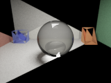
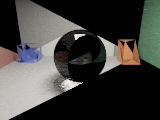
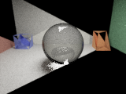

# PT 与 BDPT+MIS 收敛实验

## 实验设置

- 分辨率：160x120。
- 最大路径深度：8。
- 渲染线程：12。
- 随机重复：每个误差点 3 个独立种子。
- 参考图：高样本 BDPT；间接光/室内 4096 spp，焦散 8192 spp。
- 误差：线性 HDR 图像上的逐像素 RGB MSE。
- 等时预算：每种方法 1.0 秒，记录实际 spp 和误差。
- 焦散关注区：图像归一化坐标 `x=0.35..0.60, y=0.65..0.85`，覆盖玻璃球下缘和地面聚焦亮斑。

误差曲线见 [error_curves.svg](results/error_curves.svg)，等时误差柱图见
[equal_time_error.svg](results/equal_time_error.svg)。

## 间接光方差

固定 32 spp、3 次独立渲染的逐像素亮度方差：

| 场景 | PT 方差 | BDPT 方差 | 变化 |
|---|---:|---:|---:|
| indirect | 0.035315 | 0.026335 | 降低 25.4% |
| interior | 0.032252 | 0.033735 | 均值能量差导致原始方差略高；相对方差 0.02905 -> 0.02413，降低 16.9% |
| caustic | 0.041940 | 0.055813 | 低 spp 下 `t=1` 光子 splat 更稀疏；相对方差 0.6277 -> 0.5877，降低 6.4% |

间接光场景中，BDPT 的像素方差和相对方差均明显低于 PT，说明光源子路径补充了相机侧难以采样的多次漫反射能量。

## 固定样本收敛

下表为 MSE（越低越好）：

| 场景 | 方法 | 16 spp | 64 spp | 256 spp | 16..256 拟合斜率 |
|---|---|---:|---:|---:|---:|
| indirect | PT | 0.10304 | 0.04904 | 0.03485 | -0.39 |
| indirect | BDPT | 0.05986 | 0.01500 | 0.00686 | -0.78 |
| interior | PT | 0.28412 | 0.24312 | 0.23111 | -0.07 |
| interior | BDPT | 0.06407 | 0.01841 | 0.00617 | -0.86 |
| caustic | PT | 0.18618 | 0.13804 | 0.12472 | -0.15 |
| caustic | BDPT | 0.09455 | 0.02482 | 0.00723 | -0.92 |

在 256 spp 时，BDPT 相对 PT 的 MSE 降幅分别为：

- 间接光：5.08 倍。
- 室内：37.5 倍。
- 焦散：17.2 倍。

BDPT 在三个场景都呈现更陡的误差下降趋势；PT 在玻璃焦散上的斜率约为 -0.15，而 BDPT 约为 -0.92。

## 相同墙钟时间

每种方法 3 次 1.0 秒渲染的平均值：

| 场景 | 方法 | 实际 spp | MSE | 相对 PT |
|---|---|---:|---:|---:|
| indirect | PT | 741.3 | 0.031872 | 1.00x |
| indirect | BDPT | 335.0 | 0.005645 | 5.65x 更低 |
| interior | PT | 241.7 | 0.233105 | 1.00x |
| interior | BDPT | 227.0 | 0.006994 | 33.33x 更低 |
| caustic | PT | 397.3 | 0.121662 | 1.00x |
| caustic | BDPT | 85.7 | 0.020261 | 6.01x 更低 |

焦散关注区在同一 1 秒预算下：

| 方法 | 实际 spp | 焦散区 MSE | 相对 PT |
|---|---:|---:|---:|
| PT | 397.3 | 1.902512 | 1.00x |
| BDPT | 85.7 | 0.275148 | 6.91x 更低 |

BDPT 在焦散场景只完成了 PT 约 21.6% 的每像素样本数，但整图 MSE 降低约 6.0 倍，焦散关注区 MSE 降低约 6.9 倍。该结果确认了双向路径在镜面-漫反射-光源焦散路径上的收敛优势。

具体地，BDPT 在相同 1 秒内的整图参考误差为 `MSE=0.02026 / RMSE=0.14234`，焦散关注区为 `MSE=0.27515 / RMSE=0.52455`。

## 结论

1. 双向子路径和 MIS 显著增加了有效路径策略，避免 PT 在焦散和复杂室内间接光中依赖低概率的相机侧采样。
2. 固定样本下，BDPT 在焦散和室内场景的误差下降斜率明显更陡。
3. 相同 1 秒预算下，BDPT 在三个场景的参考 MSE 均更低；焦散场景的整图与焦散区误差分别降低约 6.0 倍和 6.9 倍。
4. 低 spp 时焦散 `t=1` splat 的固定样本方差可能高于 PT，但随着样本数增加误差快速下降；等时误差指标更适合评价其实际收益。

## 参考图

焦散场景 1 秒等时对比（左：PT，右：BDPT）：

