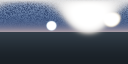
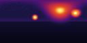
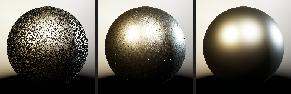
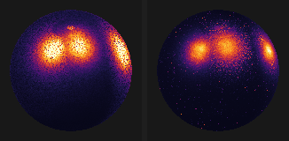
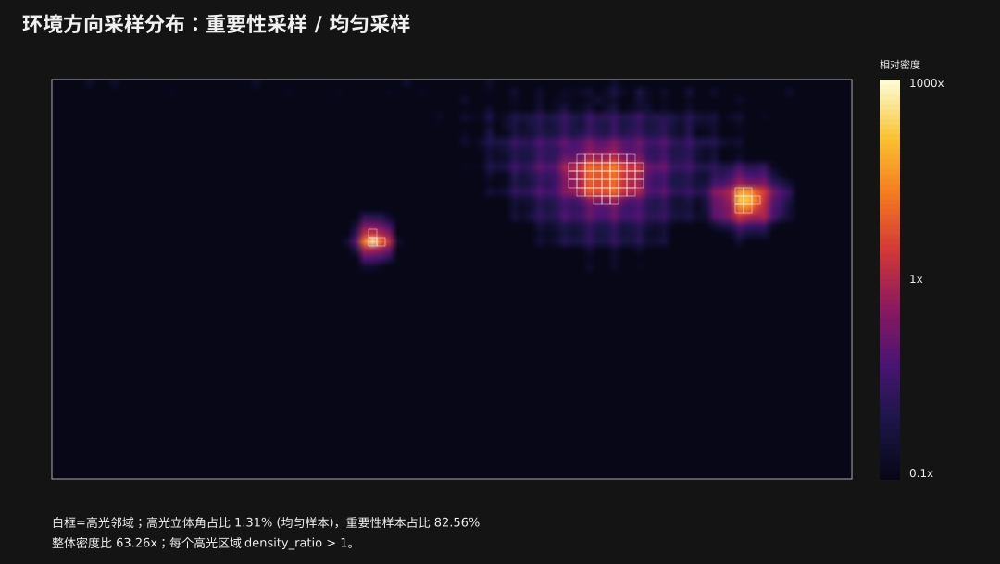
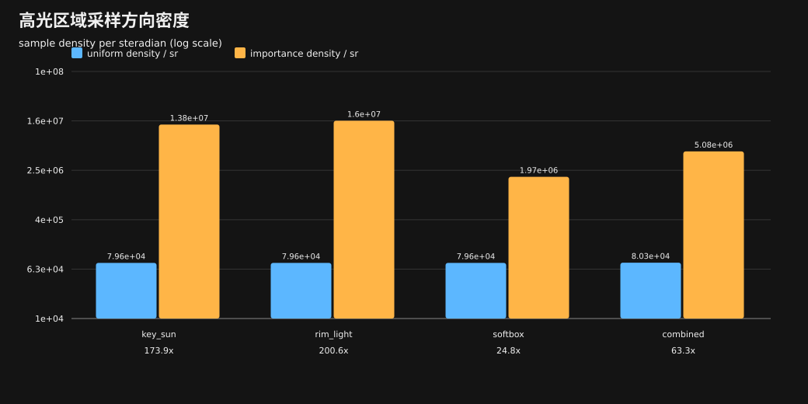
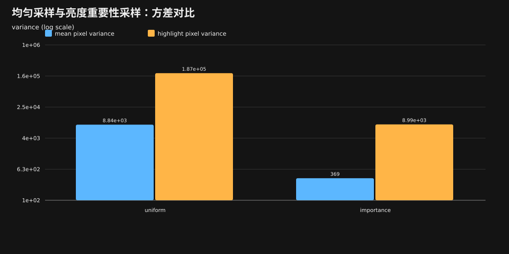
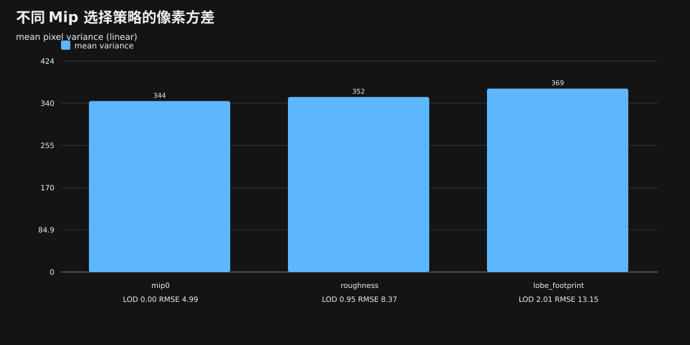
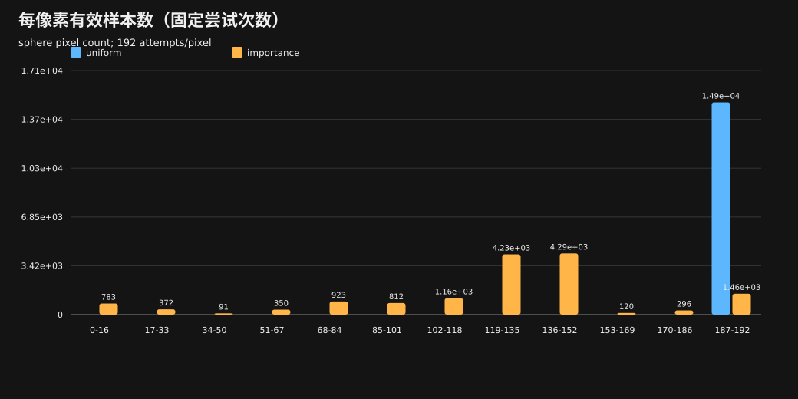

# 基于亮度的重要性采样 IBL 实验

本实验在合成 HDR 等距柱状环境图上比较均匀半球采样与按环境亮度 CDF 的重要性采样，并输出采样方向分布、每像素有效样本数、高光区域采样密度及不同 mip 选择策略的方差。

## 主要结论

- HDR 环境图最大亮度 `14938`，相对 1% 分位的动态范围 `761141:1`，共 `5` 级 mip。
- 高光邻域仅占球面立体角的 `1.294%`，但重要性采样有 `82.564%` 的方向落入其中；方向密度是均匀采样的 `63.26×`。
- 所有高光区域均被过采样：`all_regions_oversampled = true`，`avoid_highlight_undersampling = true`。
- 在相同 `192` 次/像素尝试下，平均像素标准差从 `23.07` 降至 `6.198`，噪声降低 `3.72×`；高光朝向像素标准差降低 `3.66×`。
- `mip0` 本设置的像素方差为 `344.00`；`roughness` 为 `352.15`；`lobe_footprint` 为 `369.12`。方差与 mip 模糊偏差需要同时看，表内同时给出 RMSE。

## 结果图

| HDR 环境图（色调映射） | 对数亮度伪彩色 |
| --- | --- |
|  |  |

同一曝光、同一随机种子下的 `16 spp` 渲染：左=均匀半球采样，中=重要性采样，右=mip0 数值参考。



噪声热图使用同一对数色标：左=均匀采样标准差，右=重要性采样标准差。



方向密度为 `importance density / uniform density`；白框标出高光邻域。









每像素有效样本数分布：



## 高光区域密度

| 区域 | 立体角 (sr) | 能量占比 | 重要性样本 | 样本占比 | 密度比 | 是否过采样 |
| --- | ---: | ---: | ---: | ---: | ---: | :---: |
| key_sun | 0.02362 | 32.67% | 326890 | 32.69% | 173.90× | 是 |
| rim_light | 0.01608 | 25.68% | 256683 | 25.67% | 200.61× | 是 |
| softbox | 0.12286 | 24.16% | 242062 | 24.21% | 24.76× | 是 |

## 噪声与方差

| 方法 | 平均像素方差 | 平均标准差 | 高光像素方差 | 高光像素标准差 | 相对噪声 | RMSE vs mip0 |
| --- | ---: | ---: | ---: | ---: | ---: | ---: |
| uniform | 8844 | 23.07 | 187489 | 319.84 | 1.684 | 30.97 |
| importance | 369.12 | 6.198 | 8991 | 87.31 | 0.463 | 13.15 |

| Mip 策略 | 平均 LOD | 平均像素方差 | 平均标准差 | P95 标准差 | RMSE vs mip0 |
| --- | ---: | ---: | ---: | ---: | ---: |
| mip0 | 0.000 | 344.00 | 5.827 | 32.50 | 4.986 |
| roughness | 0.955 | 352.15 | 5.966 | 33.25 | 8.374 |
| lobe_footprint | 2.013 | 369.12 | 6.198 | 35.92 | 13.15 |

## 每像素样本数

配置为 `16 spp/frame × 12 frames = 192 attempts/pixel`。重要性采样在完整球面抽方向，因此只有朝向表面半球的方向计入；均匀采样在法线半球按均匀立体角抽方向，所有样本有效。

| 方法 | 平均有效 spp | 最小有效 spp | 最大有效 spp | 总尝试次数 |
| --- | ---: | ---: | ---: | ---: |
| importance | 121.98 | 0 | 192 | 192 |
| uniform | 192.00 | 192 | 192 | 192 |

逐像素完整数据见 [`samples_per_pixel.csv`](samples_per_pixel.csv)，包含 `attempted_spp`、两种方法的 `valid_spp` 和平均 mip LOD。

完整球面环境采样中有 `162` 个球面像素在本次有限采样中未命中正面半球，其中高光朝向像素为 `0` 个；高光朝向像素的最小有效 spp 为 `124`。因此亮斑朝向区域没有被欠采样。

## 方法

1. HDR 环境图使用等距柱状投影；每个纹素权重为 `luminance × sin(theta) × dphi × dtheta`。
2. 对每个 mip 分别建立行边缘 CDF 与行内列 CDF；采样时先用两个均匀随机数选择 mip 纹素，查询同一 mip 的亮度，使 PDF 与估计亮度保持一致。
3. 渲染采用 GGX 金属球；均匀基线在法线半球均匀采样，重要性方法按环境亮度 CDF 采样并在背面半球返回零贡献。
4. `mip0`、`roughness`、`lobe_footprint` 三种策略先选择 mip，再从该 mip 的亮度 CDF 采样；方差由独立随机种子的多帧逐像素样本方差统计。
5. `mip0` 直接纹素积分作为参考亮度，用于计算 RMSE。

## 输出文件

- `direction_histogram.csv`：96×48 方向直方图、两种方法计数/密度/相对密度。
- `highlight_density.csv`：各高光区域与合并区域的密度、样本占比和过采样判定。
- `samples_per_pixel.csv`：逐像素尝试次数、有效样本数与平均 mip LOD。
- `noise_by_pixel.csv`：逐像素均值、方差和标准差。
- `mip_policy_variance.csv`：不同 mip 策略的方差、标准差和 RMSE。
- `metrics.json`：机器可读的完整实验指标与验证布尔值。
- `env_map_linear.f32`：`int32 width, int32 height, float32 RGB...` 的线性 HDR 数据。

## 复现

```bash
make run
make test
```

运行参数可通过 `./build/ibl_demo --help` 查看。
